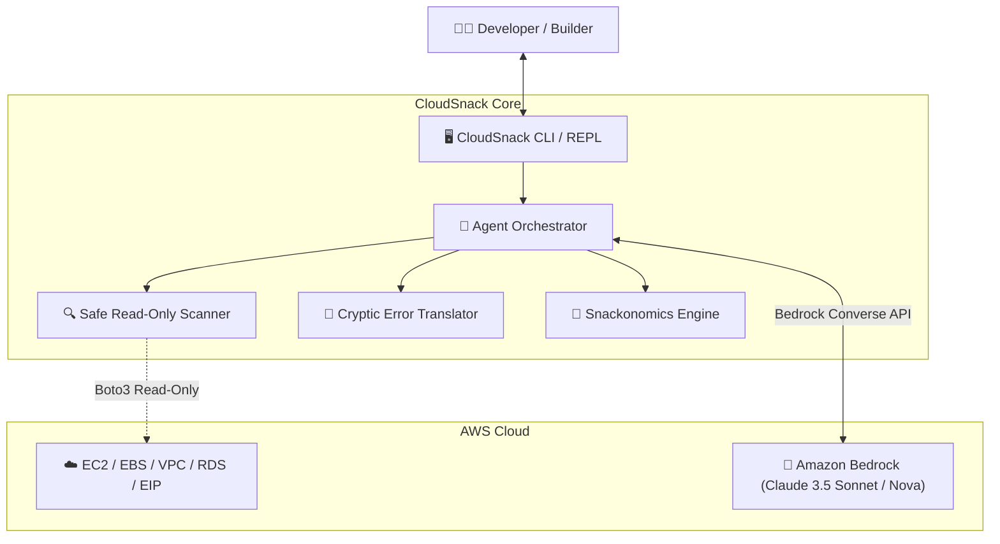

# 🍪 CloudSnack: Your Guilt-Free AWS Cloud Hygiene Companion


> *"Small and delightful beats big and clunky."* Built for the **AWS Builder Center Weekend Challenge: Build an agent people actually enjoy using**.

[](https://www.python.org/)
[](https://aws.amazon.com/bedrock/)
[](#security-promise)
[](LICENSE)

---

## 💡 What is CloudSnack?

Most cloud cost management tools feel like a terrifying audit from corporate accounting: 40-column spreadsheets, scary red percentage alerts, and cryptic ARNs like `vol-0a3f912c` leaving you feeling guilty and paralyzed.

**CloudSnack** flips the script. It is an empathetic, conversational AI agent powered by **Amazon Bedrock (Converse API)** that audits your AWS dev environment, detects idle waste (idle NAT Gateways, orphaned EBS volumes, forgotten Elastic IPs, zombie RDS databases), and translates that waste into **delicious snack units**.

Instead of:
> *"WARNING: Resource arn:aws:ec2:us-east-1:... has incurred 32.40 USD with 0 bytes processed."*

CloudSnack says:
> *"☕ Your lonely NAT Gateway in us-east-1 ate 6 oat milk flat whites this month ($32.40). It was delicious, but maybe we let it rest?"*

---

## ✨ The Delightful Details: Why People Love It

1. **Snackonomics (Relatable & Guilt-Free):** Converts abstract cloud bills into tangible daily treats—oat milk coffees, NYC pizza slices, bakery croissants, and street tacos.
2. **Zero-Anxiety First Run:** Instant, zero-friction startup. Works out of the box with pure Python standard library and includes an instant simulator mode so you can see it in action without configuring credentials first.
3. **Mercy Mode (1-Click Safe Rollbacks):** CloudSnack never deletes anything autonomously. For every finding, it gives you a copy-pasteable, pre-verified AWS CLI snippet with `--dry-run` or pre-delete snapshot recipes.
4. **Cryptic AWS Error Translator:** Hit `InvalidParameterCombination`, `ResourceInUseException`, or `SignatureDoesNotMatch`? CloudSnack translates it into plain English, reassures you that 99% of engineers make this mistake, and provides the exact 30-second fix.

---

## 🚀 Quickstart (Under 30 Seconds)

### 1. Clone & Run Demo
No extra dependencies required to test! Run the interactive guided demo immediately:

```bash
git clone https://github.com/mickotec/cloudsnack.git
cd cloudsnack
python3 run_demo.py
```

### 2. Run a Read-Only Scan
View today's "Cloud Snack Tray":
```bash
python3 -m cloudsnack.cli scan --demo
```
*(Omit `--demo` to audit your live AWS account with your standard AWS credentials)*

### 3. Translate a Scary AWS Error
```bash
python3 -m cloudsnack.cli translate "ClientError: An error occurred (InvalidParameterCombination) when calling CreateDBInstance"
```

### 4. Interactive Chat REPL
Chat conversationally with Amazon Bedrock:
```bash
python3 -m cloudsnack.cli chat --demo
```

---

## 🍱 Live Output Sample: Today's Snack Tray

```text
═════════════════════════════════════════════════════════════════════════════════
 🍱 TODAY'S CLOUD SNACK TRAY (Audit Summary)
═════════════════════════════════════════════════════════════════════════════════

RESOURCE TYPE            RESOURCE ID                COST/MO    SNACK EQUIVALENT
------------------------ -------------------------- ---------- --------------------
NAT Gateway              nat-0a98f12c8b74e11a2      $32.40     ☕ ≈ 6.2 Oat Milk Flat Whites/mo ($32.40)
Unattached EBS Volume    vol-03b9841f17e08ba45      $8.00      🍪 ≈ 3.2 Chocolate Chip Cookies/mo ($8.00)
Unassociated Elastic IP  eipalloc-017f938c4b6e890cd $3.65      🍪 ≈ 1.5 Chocolate Chip Cookies/mo ($3.65)
Stopped RDS Instance     dev-postgres-sandbox       $11.50     🍕 ≈ 2.9 NYC Pepperoni Slices/mo ($11.50)
---------------------------------------------------------------------------------
TOTAL POTENTIAL MONTHLY WASTE: $55.55 / month
SNACKONOMICS RECAP: ☕ ≈ 10.6 Oat Milk Flat Whites / month!
👉 Whoa, gourmet banquet alert! That's 10.6 ☕ Oat Milk Flat Whites a month.

🛡️  MERCY MODE: 1-CLICK SAFE REMEDIATION RECIPES
[1] NAT Gateway: nat-0a98f12c8b74e11a2
    Safe Fix CLI:
      aws ec2 describe-route-tables --filters Name=route.nat-gateway-id,Values=nat-0a98f12c8b74e11a2
      aws ec2 delete-nat-gateway --nat-gateway-id nat-0a98f12c8b74e11a2
```

---

## 🏛️ Architecture



- **Amazon Bedrock (Converse API)**: Drives the agent's contextual conversational reasoning, empathy, and remediation suggestions.
- **AWS SDK (Boto3)**: Performs non-destructive queries (`describe_volumes`, `describe_nat_gateways`, `describe_addresses`).
- **Snackonomics Engine**: Deterministic financial mapping between hourly/monthly billing rates and food equivalents.
- **Resilient Fallback Mode**: Works 100% offline or without API keys, ensuring reliable evaluations and test runs.

---

## 🛡️ Security Promise: 100% Read-Only

CloudSnack will **NEVER** run `delete-*`, `terminate-*`, or `stop-*` commands against your AWS account. It generates the safe commands for you in **Mercy Mode**, allowing you to inspect, verify, and execute them on your own terms.

---

## 🧪 Testing

Run the automated test suite:
```bash
python3 -m unittest discover -s tests -v
```

---

## 📄 License
MIT © 2026 CloudSnack Contributors.
Built with ❤️ for the AWS Builder Community.
